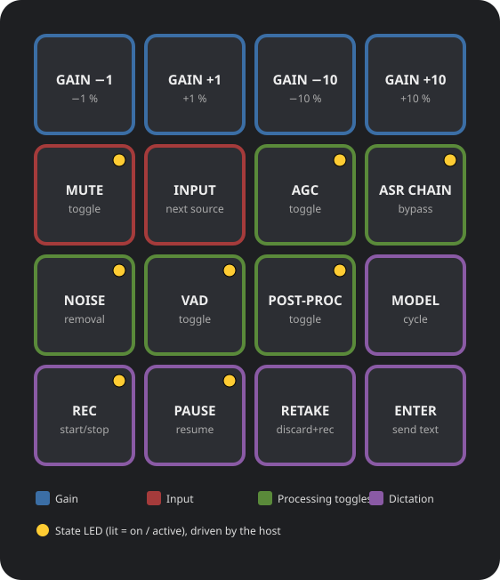

# Voice-Control 16: mic and dictation control pad

A layout for people who voice-type all day. Every key is for voice control:
microphone level and state, the audio-processing chain in front of the ASR model,
and the dictation session itself. Drafted 2026-11-11 from Daniel's key list.

*Mockup generated by [`render_mockup.py`](render_mockup.py) (stdlib Python, re-run after editing `KEYS`). The yellow dot marks a key with a state LED.*

## Key count: 16 (fits a 4×4 pad exactly)

| # | Key | Action | Type | State LED |
|---|-----|--------|------|-----------|
| 1 | Gain −1 | Input gain down 1 % | momentary | – |
| 2 | Gain +1 | Input gain up 1 % | momentary | – |
| 3 | Gain −10 | Input gain down 10 % | momentary | – |
| 4 | Gain +10 | Input gain up 10 % | momentary | – |
| 5 | Mute | Mute / unmute the mic | toggle | yes (lit = muted) |
| 6 | Input | Cycle to the next mic input source | momentary | – |
| 7 | AGC | Automatic gain control on/off | toggle | yes |
| 8 | ASR chain | Whole ASR processing chain on/off on the input stream | toggle | yes |
| 9 | Noise | Background noise removal on/off | toggle | yes |
| 10 | VAD | Voice activity detection on/off | toggle | yes |
| 11 | Post-proc | Transcript post-processing on/off | toggle | yes |
| 12 | Model | Cycle the dictation (ASR) model | momentary | – |
| 13 | Rec | Start / stop recording | toggle | yes (lit = recording) |
| 14 | Pause | Pause / resume recording | toggle | yes |
| 15 | Retake | Discard the current take and start again | momentary | – |
| 16 | Enter | Send / insert the transcribed text | momentary | – |

Totals: 4 gain, 2 input, 5 processing toggles, 5 dictation. 8 keys need a state LED
(7 toggles plus Rec; Mute counted as a toggle).

Rows in the mockup: gain on top, input + AGC/ASR chain second, processing toggles
third, dictation on the bottom row nearest the hand. Model sits with the processing
toggles to keep the dictation row to the four session keys.

## What the hardware has to do

1. **16 keys**, ideally 4×4.
2. **Host-driven per-key LEDs.** The toggle lights must reflect the real state on the
   computer (AGC can be turned off from software too), so the pad cannot just flip an
   LED on keypress. Firmware has to accept LED commands from the host: QMK raw HID or
   VIA/OpenRGB per-key RGB, or an LCD-key device that redraws per state.
3. **Linux-programmable** without a vendor Windows app. Keys send F13–F24 or similar,
   mapped by Input Remapper / KDE shortcuts as in the rest of this repo.

## Hardware candidates (not yet verified against listings)

| Option | Keys | Per-key state indication | Fit |
|--------|------|--------------------------|-----|
| QMK/VIA 4×4 pad with per-key RGB (generic 16-key, AliExpress) | 16 | RGB via QMK raw HID / OpenRGB | Exact fit; the default target |
| 4×4 QMK pad with rotary knobs (e.g. DOIO KB16-class) | 16 + knobs | RGB per key | A knob could replace the four gain keys (turn = 1 %, press-turn = 10 %), freeing 3–4 keys |
| Stream Deck MK.2 (3×5) | 15 | LCD per key | One short; drop one gain pair to 1 % / 10 % on a single key with long-press, or fold Pause into Rec |
| Stream Deck XL (4×8) | 32 | LCD per key | Room to spare; overkill for this layout |
| Stream Deck+ (2×4 + 4 dials) | 8 + 4 dials | LCD + touch strip | Dials take gain; 8 keys too few for the rest |
| ESP32 / RP2040 custom build (see [Claude-Pad specs](https://github.com/danielrosehill/Claude-Pad/tree/main/specs)) | 16 | Single-colour LEDs per key, host-driven over serial/HID | Full control over LEDs; most work |

Open question: whether gain belongs on a knob rather than four keys. A knob is the
more natural control for a continuous value and would leave spare keys.

## Host side (not built)

The keys only matter if each action exists as a command on the host: PipeWire/WirePlumber
for gain, mute and source (`wpctl set-volume @DEFAULT_SOURCE@ 1%+`,
`wpctl set-mute @DEFAULT_SOURCE@ toggle`); the AGC, ASR-chain, noise and VAD toggles
depend on how the dictation pipeline exposes them (filter-chain nodes or app settings).
A small state daemon would read those states and push LED updates to the pad.
